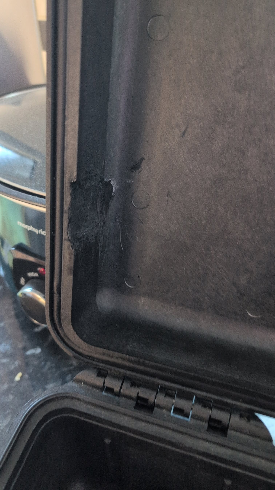

# Pelicase 1450 Portable Workstation

An AC-powered, transportable desktop workstation housed inside a Peli 1450 protective case, built primarily from repurposed off-the-shelf desktop components and running a Windows 10 and Linux Mint dual-boot environment.

## Overview & Purpose
Built to consolidate spare desktop hardware into a self-contained, easily transportable workstation without requiring an external monitor setup. The system operates on standard mains AC power with the lid open for airflow and screen visibility, serving as a cross-OS testing, diagnostics, and general computing machine.

## Hardware Specifications

| Component    | Part/model                              | Notes                                                                                                 |   |   |
|--------------|-----------------------------------------|-------------------------------------------------------------------------------------------------------|---|---|
| Enclosure    | Peli 1450 Protector case                | Custom-fitted with Peli 1450-dimensioned Shadow Foam                                                  |   |   |
| Motherboard  | ASRock Fatal1ty AB350 Gaming-ITX/ac     | Mini-ITX form factor using 3M motherboard standoffs                                                   |   |   |
| CPU & Cooler | AMD Ryzen 7 1700 + Stock Wraith Cooler  | 8-core / 16-thread                                                                                    |   |   |
| GPU          | NVIDIA GeForce GTX 1070                 | Outputs via HDMI with a right angle adapter to internal lid display                                   |   |   |
| Memory       | Corsair Vengeance DDR4 (12GB @ 2666MHz) | Repurposed kit                                                                                        |   |   |
| Storage      | Crucial BX500 2TB SSD                   | Partitioned for Windows 10 / Linux Mint dual-boot                                                     |   |   |
| Power Supply | Corsair CS750M (750W Semi-Modular)      | Mains AC input, secured with double sided 3M sticky pads                                              |   |   |
| Display      | Arzopa 15.6" 1080p IPS Portable Monitor | Mounted inside the lid using tailored Shadow Foam                                                     |   |   |
| Front I/O    | Salvaged NZXT S340 Front Panel I/O      | Integrated for accessible power switch, USB, and audio ports. Secured to sidewall with 3M sticky pads |   |   |
|              |                                         |                                                                                                       |   |   |

## Physical Integration & Custom Modifications

* **Lid Display & HDMI Clearance:** The Arzopa portable display is recessed into pre-sized Shadow Foam inside the case lid. A small clearance relief was cut into the side of the lid/foam channel to accommodate a right-angle Mini-HDMI to HDMI cable without putting strain on the display port or pinching the cable when the lid is closed.
* **Salvaged Front Panel I/O:** The front I/O module from an NZXT S340 chassis was repurposed and mounted inside the case to provide accessible power/reset controls and external USB/audio connectivity without reaching the rear motherboard shield.
* **Thermal & Power Operation:** Requires direct mains AC power to the Corsair CS750M PSU. The case is operated strictly with the lid open to ensure unobstructed intake and exhaust airflow across the Ryzen stock cooler, GTX 1070, and PSU.

## Operating System & Dual-Boot Setup
* **Bootloader:** GRUB managing dual-boot selection on the 2TB Crucial SSD.
* **Windows 10:** Used for Windows-native software, hardware utilities, and general desktop workloads.
* **Linux Mint:** Used for Bash scripting, network diagnostics, and Linux administration practice.