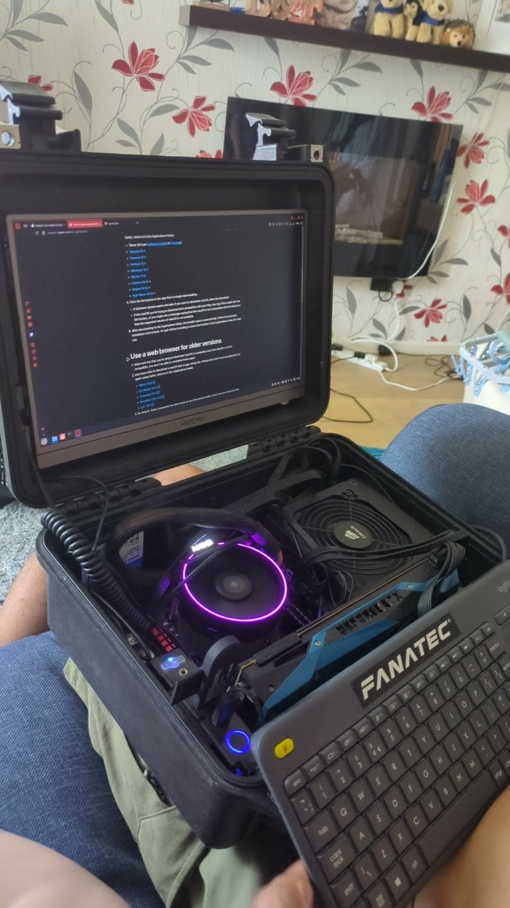
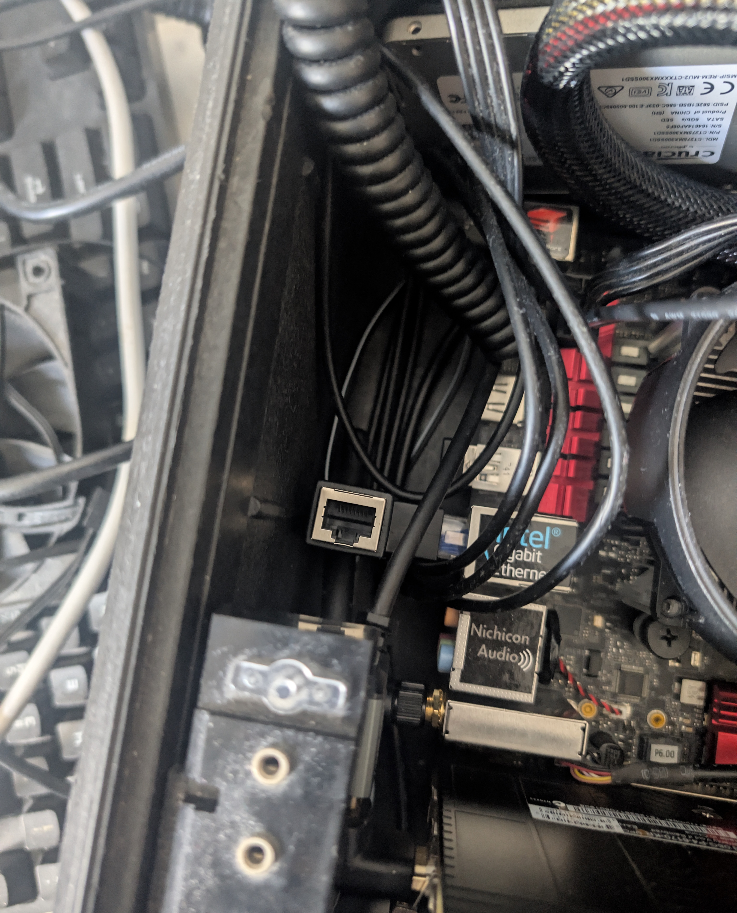

# Pelicase 1450 Portable Workstation

An AC-powered, transportable desktop workstation housed inside a Peli 1450 protective case, built primarily from repurposed off-the-shelf desktop components and running a Windows 10 and Linux Mint dual-boot environment.

<table>
  <tr>
    <th align="center" width="50%">Open Workstation</th>
    <th align="center" width="50%">Working Workstation (Linux Mint)</th>
  </tr>
  <tr>
    <td align="center" width="50%"></td>
    <td align="center" width="50%"></td>
  </tr>
</table>

## Overview & Purpose
Built to consolidate spare desktop hardware into a self-contained, easily transportable workstation without requiring an external monitor setup. The system operates on standard mains AC power, serving as a cross-OS testing and diagnostics workstation—and previously filling in as a temporary Proxmox compute node for my homelab via a swappable SSD.

## Hardware Specifications

| Component          | Part/model                                                        | Notes                                                                                                 |
|--------------------|-------------------------------------------------------------------|-------------------------------------------------------------------------------------------------------|
| Enclosure          | Peli 1450 Protector case                                          | Custom-fitted with Peli 1450-dimensioned Shadow Foam                                                  |
| Motherboard        | ASRock Fatal1ty AB350 Gaming-ITX/ac                               | Mini-ITX form factor using 3M motherboard standoffs                                                   |
| CPU & Cooler       | AMD Ryzen 7 1700 + Stock Wraith Cooler                            | 8-core / 16-thread                                                                                    |
| GPU                | NVIDIA GeForce GTX 1070                                           | Outputs via HDMI                                                                                      |
| Memory             | Corsair Vengeance DDR4 (12GB @ 2666MHz)                           | Repurposed kit                                                                                        |
| Storage            | Crucial BX500 2TB SSD                                             | Partitioned for Windows 10 / Linux Mint dual-boot                                                     |
| Power Supply       | Corsair CS750M (750W Semi-Modular)                                | Mains AC input, secured with double sided 3M sticky pads                                              |
| Display            | Arzopa 15.6" 1080p IPS Portable Monitor                           | Mounted inside the lid using tailored Shadow Foam                                                     |
| Front I/O          | Salvaged NZXT S340 Front Panel I/O                                | Integrated for accessible power switch, USB, and audio ports. Secured to sidewall with 3M sticky pads |
| Adapters & Cabling | Right-angle RJ45, Mini-HDMI-to-HDMI + right-angle HDMI, 90° USB-C | Low-profile routing for lid clearance and rear I/O access                                             |                                       

## Physical Integration & Custom Modifications

* **Lid Display & HDMI Clearance:** The Arzopa portable display is recessed into pre-sized Shadow Foam inside the case lid. A small clearance relief was cut into the side of the lid/foam channel to accommodate a right-angle Mini-HDMI to HDMI cable without putting strain on the port or pinching the cable when the lid is closed.
* **Salvaged Front Panel I/O:** The front I/O module from an NZXT S340 chassis was repurposed and mounted inside the case to provide accessible power/reset controls and external USB/audio connectivity without reaching the rear motherboard shield.
* **Thermal & Power Operation:** Requires direct mains AC power to the Corsair CS750M PSU. The case is operated strictly with the lid open to ensure unobstructed intake and exhaust airflow across the Ryzen stock cooler, GTX 1070, and PSU.

<table>
  <tr>
    <th align="center" width="50%">Lid HDMI Clearance & Internal Layout</th>
    <th align="center" width="50%">Pre-Shadow Foam Workstation (Linux Mint)</th>
  </tr>
  <tr>
    <td align="center" width="50%"></td>
    <td align="center" width="50%"></td>
  </tr>
</table>

### Cable Routing & Clearance Modifications

To keep the external Peli 1450 shell intact while fitting full-size desktop components, several low-profile adapters and minor internal reliefs were required:

* **Display Power & Video (Lid):** Cut a small relief notch into the upper-left lid rim and Shadow Foam bezel to seat a right-angle Mini-HDMI-to-HDMI connector, connecting to the GPU with a repurposed right-angle HDMI adapter at the GPU end, paired with a 90-degree USB-C power lead routed down along the hinge channel.
* **Rear I/O Access:** Installed an upward-facing right-angle RJ45 Ethernet adapter on the motherboard rear I/O to allow top-down network patching despite tight wall clearance.

| Lid Display Relief & Right-Angle Leads | Rear I/O Right-Angle Ethernet Adapter |
| :---: | :---: |
|  |  |

## Operating System & Dual-Boot Setup
* **Bootloader:** GRUB managing dual-boot selection on the 2TB Crucial SSD.
* **Windows 10:** Used for Windows-native software, hardware utilities, and general desktop workloads.
* **Linux Mint:** Used for Bash scripting, network diagnostics, and Linux administration practice.
* **Temporary Homelab Compute Node (Swappable Proxmox SSD):** Previously served as a temporary compute node in https://github.com/frazerlab-net/proxmox-enterprise-lab via a separate Proxmox VE SSD to host Windows VMs until a dedicated second mini PC was added. I still retain the configured Proxmox drive, allowing the workstation to be dropped back in as a spare node if needed.

## Design Trade-Offs & Lessons Learned

* **Weight & Lap Ergonomics:** Packing a full-size ATX PSU, dedicated GPU, and desktop cooler into a Peli 1450 makes the unit noticeably heavier than a standard laptop, limiting extended lap use and making it best suited for desk or tabletop operation, though lap use is still possible.
* **Mains AC Power Dependency:** Built around standard desktop components and a 750W ATX PSU rather than low-power mobile hardware, prioritizing compute performance and zero-cost part reuse over battery autonomy.
* **Open-Lid Thermal Operation:** Because the Peli 1450 shell remains sealed to preserve structural integrity, the system must be operated with the lid open so the Ryzen Wraith cooler, GTX 1070, and PSU have unobstructed airflow.
* **Non-Invasive Internal Mounting:** Using 3M motherboard standoffs and adhesive pads secures the hardware reliably during transport without drilling external mounting holes through the protective case, keeping it water tight to the manufacturers original standard for transportation.
* **Display Cable Clearance:** Cutting a small side clearance in the lid allowed a standard HDMI-to-right-angle Mini-HDMI cable to fit without straining the port, though a flat ribbon HDMI cable would have achieved the same result without modifying the shell.
* **Pre-Transport Preparation & Clearance:** Before closing the lid for transport, any USB peripherals/dongles must be removed from the front I/O panel, the mains power cable tucked into the corner recess, and the GPU PCIe power cable unplugged and routed down the side so it does not press against or damage the lid-mounted display. Using a low-profile 180-degree PCIe power adapter could eliminate the need to disconnect the GPU lead between uses.

| Internal Transport Configuration | Closed Peli 1450 Ready for Transport |
| :---: | :---: |
|  |  |
